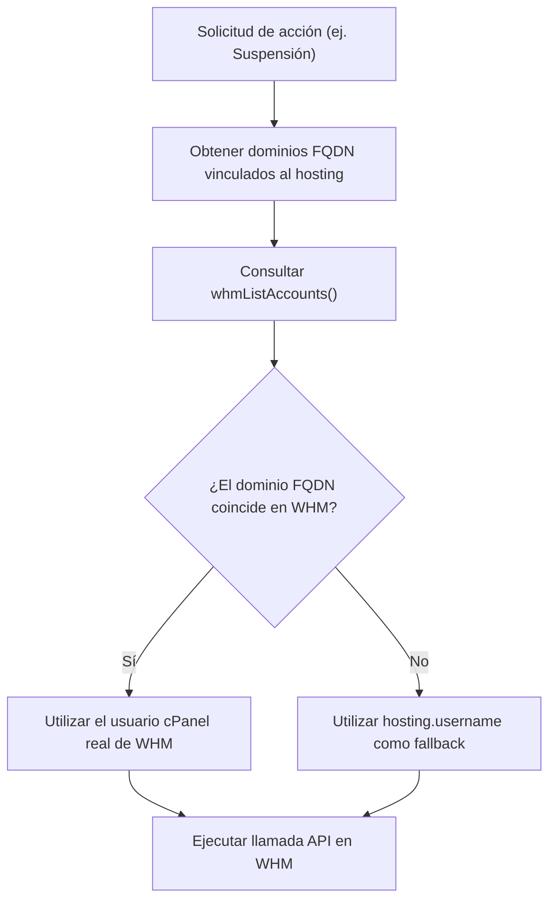

# Integración con cPanel / WHM API y Arquitectura Técnica
*Módulo de Aprovisionamiento y Sincronización en Tiempo Real*  
*Archivo Principal: `lib/whm-client.ts`*

---

## 1. Arquitectura de Conexión con WHM

El panel administrativo interactúa con el servidor de hosting cPanel mediante la API v1 de WHM en modo revendedor (*Reseller Account*):

- **Host del Servidor:** `46.224.80.244` (o `instanceshape.com` en resolución interna).
- **Puerto de Gestión:** `2087` (HTTPS con agente SSL permisivo `rejectUnauthorized: false` para certificados del servidor).
- **Usuario WHM:** `shape`
- **Cabecera de Autenticación:** `Authorization: whm shape:<WHM_API_TOKEN>`

### ⚠️ Requisito Mandatorio: `api.version=1`
Las cuentas revendedoras en cPanel/WHM **requieren obligatoriamente** el parámetro de consulta `api.version=1` en todas las solicitudes `/json-api/*`.
Si este parámetro no se envía, WHM asume una llamada API v2 o legacy que requiere privilegios de `root`, respondiendo con:
```json
{
  "cpanelresult": {
    "apiversion": "2",
    "error": "Access denied",
    "data": { "reason": "Access denied", "result": "0" }
  }
}
```
Con `api.version=1`, el revendedor ejecuta con éxito las operaciones autorizadas sobre sus cuentas propias.

---

## 2. Endpoints y Funciones en `lib/whm-client.ts`

### `whmListAccounts()`
- **Endpoint WHM:** `GET /json-api/listaccts?api.version=1`
- **Propósito:** Obtiene la lista completa de cuentas cPanel activas y suspendidas, su consumo real de disco (`diskused`), plan asignado y usuario cPanel.
- **Formato de Retorno:** Objeto indexado por dominio en minúsculas:
  ```typescript
  type WhmAccountByDomain = Record<string, {
    user: string;
    suspended: number;
    diskused?: string; // ej. "801M"
  }>;
  ```

### `whmCreateAccount(params)`
- **Endpoint WHM:** `GET /json-api/createacct?api.version=1&username=...&domain=...&plan=...&password=...`
- **Propósito:** Creación y aprovisionamiento automático de una nueva cuenta cPanel.
- **Validaciones:** Nombre de usuario alfanumérico (máx. 16 caracteres), plan existente en WHM, asignación de correo de contacto.

### `whmSuspendAccount(username, reason)`
- **Endpoint WHM:** `GET /json-api/suspendacct?api.version=1&user=...&reason=...`
- **Propósito:** Bloqueo preventivo de la cuenta por impago o requerimiento administrativo.

### `whmUnsuspendAccount(username)`
- **Endpoint WHM:** `GET /json-api/unsuspendacct?api.version=1&user=...`
- **Propósito:** Desuspensión inmediata de la cuenta cPanel tras validar el pago.

### Cambio de Paquete (`changepackage`)
- **Endpoint WHM:** `GET /json-api/changepackage?api.version=1&user=...&pkg=...`
- **Propósito:** Modifica los límites de almacenamiento, correos, dominios addon y antispam asignados a la cuenta en tiempo real.

---

## 3. Resolución Inteligente de Nombres de Usuario cPanel

En la base de datos local, un servicio de hosting puede tener registrado un nombre de usuario que difiera ligeramente del identificador de cPanel. Para evitar fallos en operaciones críticas (como suspender o cambiar paquete), el sistema utiliza el algoritmo `resolveWhmUsername`:



---

## 4. Estructura de Paquetes en Base de Datos vs WHM

Los paquetes del panel administrativo (`hosting_packages`) tienen correspondencia exacta con los paquetes creados en WHM:

| ID en Base de Datos | Nombre en WHM | Cuota Disco | Límite Ancho de Banda | Correos | Dominios Addon | Antispam/Hora |
| :--- | :--- | :---: | :---: | :---: | :---: | :---: |
| `shape_bronze` | `shape_bronze` | 500 MB | 50 GB | 5 | 0 | 20 / hora |
| `shape_silver` | `shape_silver` | 1.000 MB | 100 GB | 5 | 0 | 20 / hora |
| `shape_gold` | `shape_gold` | 2.000 MB | 200 GB | Ilimitadas | 1 | 60 / hora |
| `shape_platinum` | `shape_platinum` | 5.000 MB | 500 GB | Ilimitadas | 2 | 60 / hora |
| `shape_diamond` | `shape_diamond` | 10.000 MB | 1 TB | Ilimitadas | Ilimitados | 300 / hora |
| `shape_ssh` | `shape_ssh` | **Ilimitado** | **Ilimitado** | Ilimitadas | Ilimitados | **Shell SSH Activo (`HASSHELL=y`)** |

> **Nota sobre `shape_ssh`:** Este paquete se utiliza de forma transitoria para habilitar acceso por terminal SSH a cuentas cPanel para mantenimientos, migraciones con rsync/wp-cli o restauraciones de backups de gran tamaño. Una vez concluida la labor técnica, la cuenta es regresada a su paquete comercial original.

---

## 5. Variables de Entorno Requeridas en `.env`

```ini
# WHM API Configuration
WHM_HOST=46.224.80.244
WHM_PORT=2087
WHM_USER=shape
WHM_API_TOKEN=TU_TOKEN_GENERADO_EN_WHM
```
